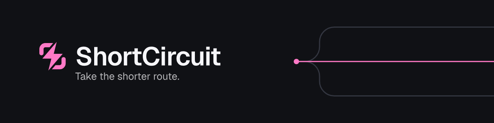

# ShortCircuit



ShortCircuit is a self-hosted URL shortener and link manager. It uses Rust and SQLite and is designed to run in one Docker container. You can recreate an existing short URL by configuring its original host and creating a link with the same slug.

**0.7.0-preview.1.** ShortCircuit is licensed under the [MIT License](LICENSE). See the [project plan](docs/PROJECT_PLAN.md) and [verification status](docs/PROJECT_STATUS.md).

## Install on Unraid

Download `my-shortcircuit.xml` from the [GitHub prerelease](https://github.com/Buffer379x/shortcircuit/releases/tag/v0.7.0-preview.1) and select it in Unraid Docker Manager. Docker Manager pulls the versioned amd64 image from GitHub Container Registry and initializes its data volume automatically. [Installation and upgrade](docs/UNRAID_INSTALLATION.md)

## Start the local container

```sh
docker compose up --build --wait
docker compose exec -T shortcircuit shortcircuit setup-token
```

Open `http://localhost:8081` and enter the one-time token, a username, and a password. The token expires after 15 minutes. Use the admin interface to create short links, edit their destinations and tags, and provision scoped API keys. Local short links are served on port 8080. Local backups are available on demand and can be scheduled. [Backup and restore](docs/BACKUP_RESTORE.md)

The Analytics page shows UTC daily counts, period comparisons, and privacy settings. QR codes are available from the link list.

Compose builds the development image `shortcircuit:0.7.0-preview.1`, publishes both ports on loopback, and runs as UID/GID 10001. The application uses one persistent Docker volume. For a reverse proxy, set `ADMIN_ORIGIN` to the external HTTPS origin and keep the cleartext admin backend reachable only by the proxy. Use a dedicated admin hostname. [Network setup](docs/REVERSE_PROXY.md)

Upgrading from 0.6.0-preview.2 preserves the existing administrator and links. Startup writes a verified pre-upgrade snapshot to `/data/backups/pre-upgrade` first. Follow the [upgrade instructions](docs/UNRAID_INSTALLATION.md#persistent-storage-and-updates). When upgrading from a development build that predates administrator accounts, remove `ADMIN_TOKEN_FILE` and use `setup-token` to claim the first account. Issue scoped keys from the admin interface. For account recovery, run `docker compose exec -T shortcircuit shortcircuit recovery-token` and choose **Reset password** on the sign-in screen.

## Build from source

Use Rust 1.100.0 and Node 24.22.3. Build the admin assets before starting the Rust process.

```sh
npm ci --prefix frontend
npm run build --prefix frontend
cargo run --locked
```

Run `cargo run --locked -- setup-token` in a second shell, using the same `DATA_DIR` if configured. The Docker image embeds the frontend in the Rust binary. [API reference](docs/API.md) · [CI results](https://github.com/Buffer379x/shortcircuit/actions)

## Interface

The admin interface uses the Polar Signal design system: a dark-first, near-monochrome interface with pink as the signal color, Geist type, and a light theme. [Design system](docs/DESIGN_SYSTEM.md) · [UI guidelines](docs/UI_GUIDELINES.md) · [Branding](docs/BRANDING.md)

## Documentation

- [Project plan](docs/PROJECT_PLAN.md), [feature matrix](docs/FEATURE_MATRIX.md), and [roadmap](docs/ROADMAP.md)
- [Architecture](docs/ARCHITECTURE.md), [data model](docs/DATABASE.md), [API](docs/API.md), and [performance](docs/PERFORMANCE.md)
- [Threat model](docs/THREAT_MODEL.md), [security](docs/SECURITY.md), [privacy](docs/PRIVACY.md), and [backup and restore](docs/BACKUP_RESTORE.md)
- [Unraid](docs/UNRAID_INSTALLATION.md), [Nginx Proxy Manager](docs/REVERSE_PROXY.md), and [testing](docs/TESTING.md)
- [Decisions](docs/DECISIONS.md), [name and licensing](docs/NAME_AND_LICENSE.md), and [contributor guidance](CLAUDE.md)
