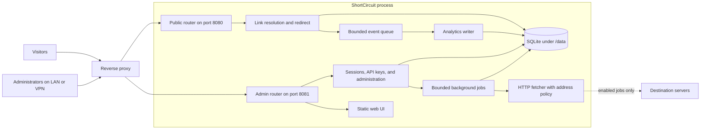

# Architecture

ShortCircuit provides public redirects, SQLite storage, authenticated link management, and separate HTTP listeners. The target architecture uses a single Rust process and one ShortCircuit container with a local persistent volume. An existing reverse proxy terminates TLS and routes public and administrative traffic to separate listeners.

## Operating Boundaries

| Surface | Access | Responsibilities |
|---|---|---|
| Public listener, port 8080 | Reverse proxy and configured hostnames | `GET` and `HEAD` for short links. The target architecture allows narrowly scoped confirmation actions for protected links. |
| Admin listener, port 8081 | Prefer a LAN or VPN, reverse proxy, and application authentication | UI, API, setup, system status, backups, and native imports. |
| Local CLI | Operator with access to the container and app data | Setup token, recovery, status probe, and maintenance procedures through the same binary. |
| Persistence | One active application process per local database | Data, backups, and assets under `/data`. See [Database Design](DATABASE.md). |

Independent routers let the public listener resolve slugs such as `/api` or `/admin`. Route prefixes, `/robots.txt`, QR suffixes, and future landing pages require explicit collision checks for each domain. The admin router and planned single-page app fallback belong on the admin listener. Liveness and readiness return only an HTTP status. The CLI probe checks readiness through that listener. Database initialization or schema upgrade failure prevents listener startup. The target architecture also checks for exclusive use of the data directory at startup and requires an authenticated admin for detailed diagnostics. Serving both listeners on one domain is optional and requires distinct prefixes, a security review, and routing tests.

## Technology Choices

The technology review records the candidates evaluated on November 25, 2026. The repository pins Rust 1.100.0. Dependency approval includes license, maintenance, advisories, minimum supported Rust version, transitive features, and build behavior. [Rust Releases](https://blog.rust-lang.org/releases/)

| Area | Proposed stack | Alternatives evaluated |
|---|---|---|
| HTTP | Axum 0.8, Tokio, Tower and Tower HTTP, Serde, and Tracing. Explicit router and middleware layers allow in-process testing of the listener boundary. [Axum](https://docs.rs/axum/latest/axum/) | Actix Web is a viable alternative with its own middleware. Using Hyper directly adds framework work. [Actix Web](https://docs.rs/actix-web/latest/actix_web/) |
| Database | SQLx 0.9 with Tokio, schema migrations, and bundled SQLite verified against the minimum patched version. Use static SQL, parameterized values, and a bounded connection pool. [SQLx SQLite](https://docs.rs/sqlx/latest/sqlx/sqlite/) | Rusqlite offers backup bindings and fits a dedicated blocking executor. PostgreSQL becomes a candidate if measurements show a write bottleneck or the deployment needs multiple active instances. |
| Contracts | Versioned request and response types, OpenAPI from Utoipa (6.x in the evaluation), and a TypeScript client generated from the same specification. Cover schemas and API contracts with tests. [Utoipa](https://docs.rs/utoipa/latest/utoipa/) | Handwritten OpenAPI supports designing the specification before the code and needs drift checks. |
| Outbound HTTP | Evaluate Reqwest with Rustls and default features disabled. A single HTTP fetcher must verify that connections use validated addresses. [Reqwest ClientBuilder](https://docs.rs/reqwest/latest/reqwest/struct.ClientBuilder.html) | Hyper with Rustls and a connection-specific connector is an option if validation with Reqwest leaves DNS, SNI, or connection pooling requirements unmet. |
| URLs and cryptography | Use `url` to parse and validate destinations, with a separate field for the exact value to send. Use RustCrypto Argon2id for passwords and OS-provided cryptographic randomness through `getrandom` or suitable standard libraries. [URL Standard](https://url.spec.whatwg.org/) · [RustCrypto Argon2](https://docs.rs/argon2/latest/argon2/) | Custom URL normalization and cryptographic primitives raise implementation risk. |
| QR | Evaluate `qrcode` and `fast_qr`. Generate a matrix, encode PNG locally, and produce deterministic SVG from numeric values and colors. Test with an independent decoder. [qrcode](https://docs.rs/crate/qrcode/latest) · [fast_qr](https://docs.rs/fast_qr/latest/fast_qr/) | Browser-side export can serve previews. API and QR image endpoints still need server-side generation. |
| Admin UI | Build Svelte 5 and TypeScript statically with Vite. Use shared CSS custom properties, selective Lucide imports, typed translations, and browser `Intl` with an explicit time zone. Use native SVG for basic charts and lazy-load a chart library where interaction requires it. [Svelte](https://svelte.dev/docs/svelte/overview) · [Vite](https://vite.dev/guide/) · [Lucide](https://lucide.dev/) | HTML templates suit basic CRUD. Charts, QR previews, and large editors would require additional interaction code. A SvelteKit server adds a separate runtime. Tailwind remains an option alongside CSS tokens and components. |
| Container image | Use a multi-stage build for amd64 first, with the bundled SQLite toolchain and Node only during the static build. Evaluate a maintained glibc-compatible Distroless image pinned by digest, with a CA bundle, required time zone data, and a non-root user. Measure the same build on Debian Slim, which the Dockerfile uses. [Distroless](https://github.com/GoogleContainerTools/distroless) | A statically linked `scratch` image may be smaller and makes CA certificates, time zones, and platform compatibility harder to manage. |

Build assets with content hashes and optionally embed them and their precompressed variants in the binary. Serve the HTML shell and secret-bearing API responses without caching. Lazy-load analytics, QR Studio, and import modules. Render public errors, confirmation pages, and link pages from small server-side views. Reject executable user content. The accessibility target is WCAG 2.2 AA. [WCAG 2.2](https://www.w3.org/TR/WCAG22/)

## Public Request Resolution

1. Check the peer and derive proxy metadata from permitted sources. Match the normalized host against the configured domain. Use the public base URL from configuration. Unknown hosts receive a generic response with no fallback.
2. Accept `GET` and `HEAD` for regular links and enforce path and query size limits. Retain the raw path and apply parsing rules once. Preserve segment boundaries during decoding. Include trailing slashes, path encoding, and proxy normalization in routing tests and surface conflicts in the preview.
3. Check status, protection, and time windows in UTC. Evaluate rules in ascending priority with a unique order. The first matching rule wins. Conditions match an unknown attribute only when the rule explicitly handles `unknown`. Validate and authorize destinations and static fallbacks when saving them.
4. Send the stored destination exactly as written unless an enabled option changes it. Query forwarding and extra paths default to off. If enabled, follow the link's policy and process path, query, and fragment separately. Preserve ordering and encoding wherever the policy permits. Test destination query strings and fragments explicitly. When a destination needs conversion for a safe HTTP `Location`, such as for raw non-ASCII characters, show the encoded URI in the editor preview and save that form.
5. For a limited or one-time link, commit an atomic and durable database decision before sending `Location`. A normal `GET` redirect needs one indexed read and has no network request or synchronous analytics write. Analytics is best-effort and uses separate counters.
6. Use `302` with `Cache-Control: no-store` by default for editable destinations. Warn about caching when the editor selects a permanent status. Use temporary redirects with `Cache-Control: no-store` for limited or protected links. Missing or inactive links return a neutral error page unless a safe fallback is configured. Administrators can view the reason for denial.

Browsers can redirect to an authorized destination on a LAN. Server-side fetching follows a separate policy. The normal redirect handler returns a stored destination directly to the caller without contacting the destination server. URL cleanup and duplicate detection suggest changes for manual review.

## Modules and Failure Boundaries

- `main`, `config`, `http`, and `db` own startup, the resolver, persistence, listeners, and shutdown. Organize features by responsibility, with domains and tags initially in `links`. Routers delegate to application functions that check permissions centrally. Create directories as their modules are implemented.
- `auth`, `redirect`, `links`, `analytics`, `import`, `backup`, and `jobs` use typed inputs and outputs. Only `outbound` accesses the HTTP client. Admin and API permissions apply to raw data, bulk operations, exports, and resumed jobs.
- A bounded visit queue, a batch writer, and SQLite transaction budgets limit the effect of analytics on redirects. SQLite serializes write transactions. Backup, cleanup, monitoring, and import share bounded resources, respect shutdown, and have different maintenance requirements. During restore, pause admin writes and public redirects before switching data to protect links and counters.
- The scheduler waits until the earliest due job or a notification that changes the schedule. Health checks start disabled. When enabled, they use separate global and per-destination limits, short timeouts, and backoff with jitter for repeated failures. Treat `401`, `403`, and `429` as warnings or unknown results. Combine checks for identical destinations only when the check policies and authorization contexts also match.
- Authorized admins can see version, build, start time, job state, local resource usage, and redacted errors. The UI has no Docker socket or shell access. See [Performance](PERFORMANCE.md) and [Security](SECURITY.md).

## Release Validation

Release gates include a reproducible SQLite and backup prototype with crash recovery, a fetcher that demonstrates socket binding to validated addresses, routing tests through the intended proxy, and a benchmark on a local Unraid pool. To keep a manually recreated short URL working, check its exact host, slug, and expected redirect response through the intended proxy before switching traffic.
